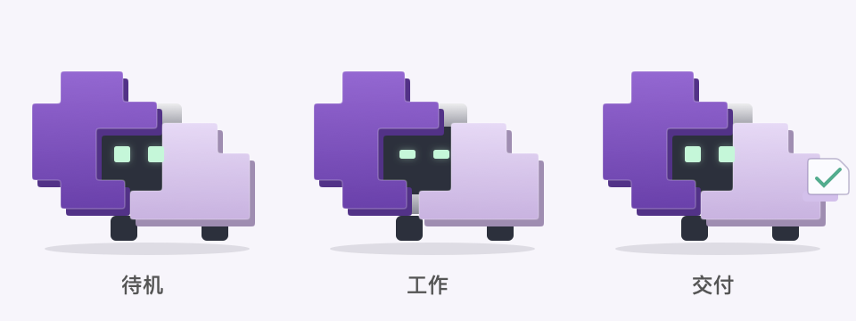
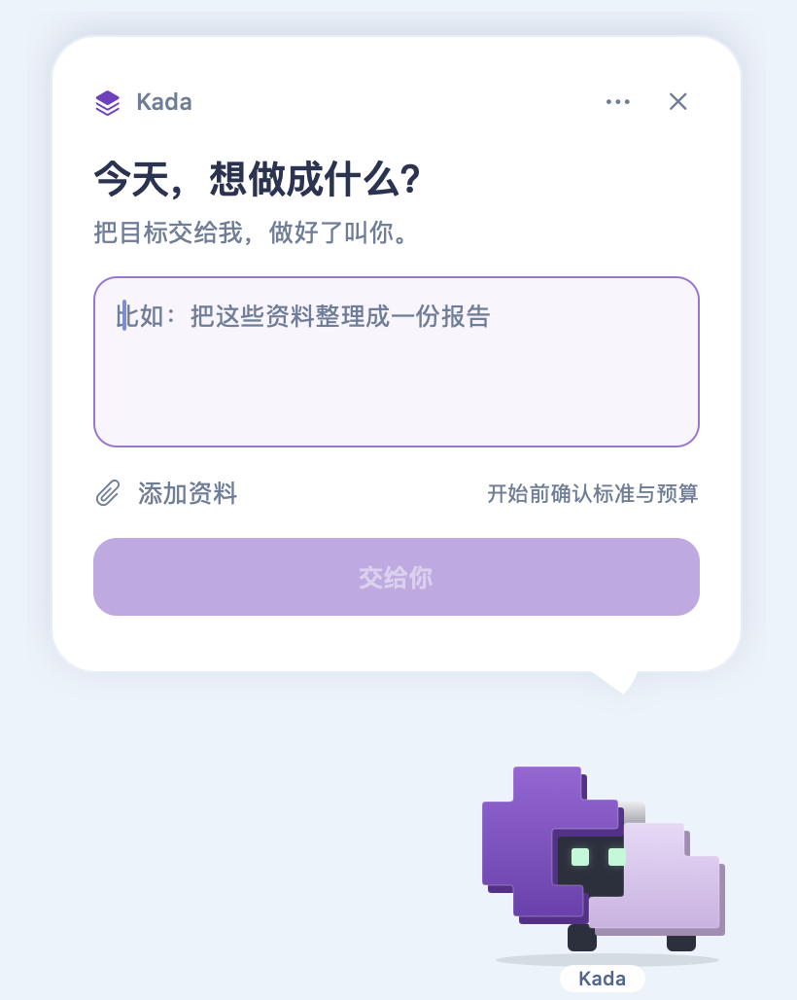

# Kada

**Set a goal. Keep the work moving.** A local AI task companion built on Pi.

[中文](README.md) · [Releases](https://github.com/muzizhi7/kada/releases) · [MIT](LICENSE)



Kada clarifies deliverables, scope, checks and a budget, asks for confirmation, then runs the task on your machine and hands back files with the checks actually performed. Use the terminal or an optional native macOS companion.

**First public source preview: v0.8.0-alpha.1.** Bring your own cloud-model credentials. There is no standalone installer yet. The desktop companion compiles from source.

## What is included

- Natural-language task preparation and one explicit confirmation.
- Background execution, pause/resume/cancel, budget tracking and reconnecting.
- File/version-bound command evidence and bounded repair after concrete failures.
- Native Pi Skills and optional discovery of existing local Agent/Skill/plugin metadata; discovered plugins are not automatically executed.
- A native macOS pixel companion with attachments, budget confirmation, customizable appearance and deliverable opening.

Pi **1.4.0** provides model access, the agent loop, tools, sessions, compaction, persistence, recovery and child sessions. Kada adds task-specific goal continuity, budget boundaries, delivery checks and local clients.

## Quick start

Requires **Node.js 24.7+** and npm. The optional desktop client also requires **macOS 13+** and Apple Swift command-line tools. Linux has a CI job; Windows is unverified.

```sh
git clone https://github.com/muzizhi7/kada.git
cd kada
npm ci --ignore-scripts
cp -n .env.example .env
npm run harness -- models deepseek
```

Edit `.env` with a provider, model ID and its key. Example:

```dotenv
MODEL_PROVIDER=deepseek
MODEL_ID=deepseek-flash
DEEPSEEK_API_KEY=replace_with_your_own_key
```

```sh
npm run chat
# Optional macOS client:
npm run pet
```

Try a task on a work copy: “Organize incoming files into a handover folder and manifest. Preserve originals, hidden files and empty files. Propose checks for omissions, collisions and failures before starting. Maximum total model cost: USD0.25.”

Review the proposed scope and budget, then confirm with `/confirm`. Use `/tasks`, `/attach`, `/status`, `/pause`, `/resume`, `/cancel` and `/quit`. Resume explicitly grants another task budget. The service and computer must stay running for background execution.

For a model-free mechanism demo, run `npm run demo`. It uses a scripted model with real Pi/file/process/SQLite behavior; it is not evidence of real-model task quality.

<details>
<summary>Native desktop preview (scripted test data)</summary>



</details>

## Boundaries

- Local execution uses cloud models. Read material may be sent to your configured provider. See [privacy and data flow](docs/PRIVACY.md).
- Shell tools run with your OS-user permissions: **there is no OS sandbox**. A workspace path is not a security boundary.
- Passing checks only establishes the facts covered by those checks, not complete semantic correctness.
- Costs are estimates; requests already in flight can exceed a configured limit.
- Automatic learning is off by default. Real computer-use is off by default. The desktop companion is a client, not a computer-use driver.
- Hour-scale reliability and repeatable quality/cost gains over Pi remain unproven. See [recorded experiments](docs/experiments/2026-11-01-office-code-results.md).

## Development

```sh
python3 -m pip install -r scripts/cases/requirements.txt
npm run check
npm audit --audit-level=moderate
npm run test:pet # macOS interactive smoke, no cloud-model requests
```

Local verification: 113 product tests; 59 native-core checks, 12 input-continuity checks and 6 customization checks. Consult Actions for the actual remote CI results. Paid model scripts require separate care and explicit execution; see [contributing](CONTRIBUTING.md).

[Usage (中文)](docs/USAGE.md) · [Desktop (中文)](docs/desktop-pet.md) · [Tryout (中文)](docs/TRYOUT.md) · [Changelog](CHANGELOG.md) · [Support](SUPPORT.md) · [Security](SECURITY.md)

## License

[MIT](LICENSE) for Kada's own source and repository-owned character assets. Dependencies, services and external experiment inputs retain their own terms; see [third-party notices](THIRD_PARTY_NOTICES.md). Built on [Pi](https://github.com/earendil-works/pi); this is an independent community project.
