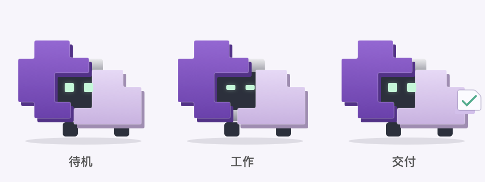

# Kada

**你定目标，我来推进。** 基于 Pi 的本地 AI 任务伙伴。

[English](README.en.md) · [快速试用](docs/TRYOUT.md) · [使用手册](docs/USAGE.md) · [发布记录](https://github.com/muzizhi7/kada/releases) · [MIT](LICENSE)



把资料整理、文件交接或代码修改的目标交给 Kada。它先与你确认交付、范围和预算，再在本机后台执行，最后交付文件、实际检查结果和仍未验证的部分。终端与可选的 macOS 原生桌面伙伴连接同一套本地服务。

> **首个公开源码预览版：v0.8.0-alpha.1。** 适合愿意配置模型密钥的开发者和早期试用者。当前没有独立安装包，桌面入口从源码编译。线上模型收费由你的供应商承担。

## 能做什么

- **确认一次，再推进任务**：自然语言整理要求，明确产物、授权范围、验收条件和预算。
- **后台执行与接回**：退出聊天后已确认任务继续；支持暂停、恢复、取消和费用查看。电脑与服务需保持运行。
- **带证据交付**：运行已有检查，绑定检查时的输入与产物版本；缺文件或检查失败时在预算内修正。
- **复用你的工作方法**：Pi 原生 Skills 按需读取；首次启动可发现已有 Agent 配置、Skills 和插件清单。插件仅列清单，不自动启动。
- **桌面伙伴**：C6 双模块像素角色，支持中文输入、添加资料、预算确认和打开交付物；可改名字和造型。

执行、模型接入、会话、压缩、持久化、恢复与子 Agent 都复用 **Pi 1.4.0**。Kada 增加目标衔接、任务预算、交付检查和本地入口。[产品范围](SPEC.md)

## 快速开始

需要 **Node.js 24.7+** 和 npm。终端入口不需要 Swift；桌面伙伴需要 **macOS 13+** 和 Apple Swift 命令行工具。Linux 已配置 CI；Windows 尚未验证。

```sh
git clone https://github.com/muzizhi7/kada.git
cd kada
npm ci --ignore-scripts
# 首次使用时创建；已有 .env 时保留原文件
cp -n .env.example .env
```

用 `npm run harness -- models [provider]` 查看已安装 Pi 的模型目录。在 `.env` 填写供应商、模型 ID 和对应密钥，例如：

```dotenv
MODEL_PROVIDER=deepseek
MODEL_ID=deepseek-flash
DEEPSEEK_API_KEY=replace_with_your_own_key
```

再启动一个入口：

```sh
npm run chat                 # 终端；自动启动或连接本地后台
npm run pet                  # 可选：macOS 原生 Kada，首次按需编译
```

在其他目录使用时指定项目路径，或在项目目录运行 `npm run chat -- --workspace /absolute/path/to/work-copy`。

你可以这样开始：

> 把 incoming 的资料整理成可交接目录和清单，保留原件、隐藏文件和空文件。先说明如何核对遗漏、重名与失败项，总费用最多 0.25 美元。

> 阅读这个项目和缺陷描述，做最小修复，保留原有测试和其他行为。先确认允许修改的范围、核对命令与预算，再执行。

说明完整展示后回复“确认开始”或 `/confirm`。普通阶段切换无需反复说“继续”；真实阻塞和预算耗尽会提示。配置和全部命令见[使用手册](docs/USAGE.md)。

### 先离线看看

```sh
npm run demo
```

此演示使用脚本化模型，运行真实 Pi、文件、进程与 SQLite，不调用线上模型。它验证机制，不代表真实模型的完成率。

<details>
<summary>桌面入口预览（原生窗口，脚本化测试数据）</summary>


</details>

## 当前边界

- **本地执行，线上模型**：任务读取的材料可能发送给选定模型供应商。本机存储不等于离线推理。[数据与权限](docs/PRIVACY.md)
- **终端使用当前用户权限，没有 OS 沙箱**。先用工作副本试用；工作目录与验收器路径检查不构成终端权限隔离。
- **检查通过只证明检查覆盖的事实**，不能保证所有业务语义正确。模型自检、命令核验和独立评审分别呈现。
- 费用是 Pi usage 的估算；在途请求可能越过额度，供应商账单为准。`/resume` 会显式追加预算。
- 自动学习默认关闭；真实 computer-use 默认关闭。桌面伙伴本身不操控其他应用。
- 小样本对照尚未证明稳定优于 Pi、普遍省钱或有效小时级可靠性。[实验记录](docs/experiments/2026-11-01-office-code-results.md) · [路线图](docs/ROADMAP.md)

## 验证与贡献

```sh
python3 -m pip install -r scripts/cases/requirements.txt # 办公案例开发依赖
npm run check
npm audit --audit-level=moderate
npm run test:pet              # macOS 原生窗口联调，不调用线上模型
```

最近本机产品回归 **113 项通过**；原生核心 **59 项核对**、中文输入连续性 **12 项**和定制流程 **6 项**通过。远端 CI 的实际结果以仓库 Actions 为准。带线上模型的脚本可能计费，参阅[贡献说明](CONTRIBUTING.md)。

欢迎用自己的真实工作副本试用，反馈可用交付、人工纠正、费用，以及是否愿意再次使用。[提交问题](https://github.com/muzizhi7/kada/issues/new/choose) · [安全报告](SECURITY.md) · [支持](SUPPORT.md)

## 文档

[使用手册](docs/USAGE.md) · [桌面伙伴](docs/desktop-pet.md) · [本机发现](docs/local-discovery.md) · [完整交接示例](examples/handover/README.md) · [变更记录](CHANGELOG.md)

## 许可证与致谢

Kada 源码和仓库自有角色素材使用 [MIT](LICENSE)。依赖、外部服务与实验下载材料保留各自条款，见[第三方说明](THIRD_PARTY_NOTICES.md)。感谢 [Pi](https://github.com/earendil-works/pi) 提供执行与会话基础，联网适配复用 DeepSeek API / 可选 Agent Reach。Kada 是独立社区项目。
