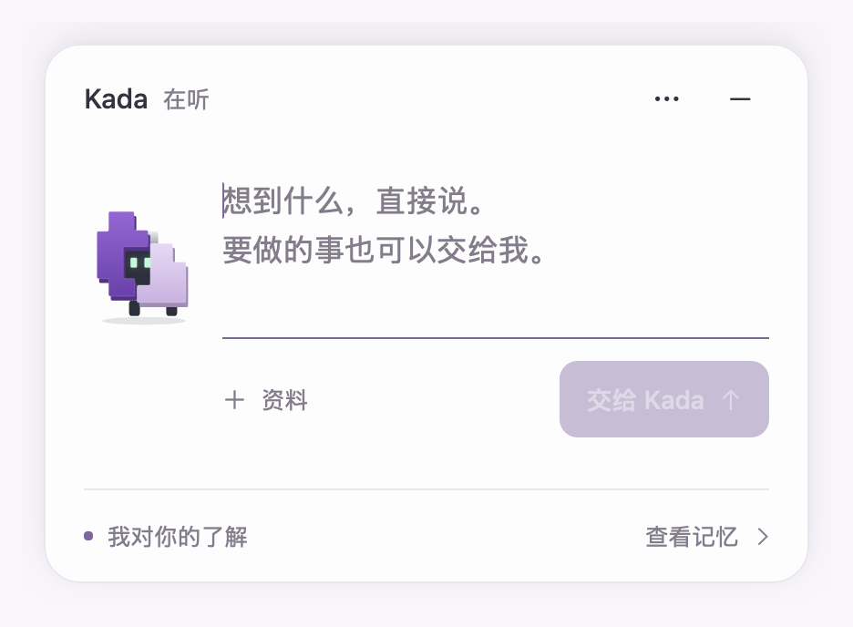
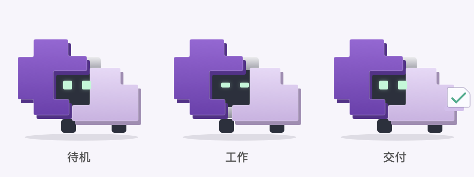

# Kada 桌面伙伴

2026-11-03 原生交接栏主分支增量：已按用户确认的 Oil UI Pro 设计落地，直接输入、普通交谈、带来源记忆、约定调整、预算确认和文件交付均连接现有本地后台。执行收起后显示任务状态条，完成仅更新为“文件已就绪”，等待用户打开。[原生实施与验证](verification-2026-11-03-handoff.md)。



2026-11-03 普通对话主分支增量：新对话默认直接回答，记忆交流与结束语不会被强制创建为 Goal。气泡直接展示 Pi 的普通回复并保留继续输入；实际交付请求才提出任务说明，确认后仍安静执行和验收。回复是已有 Pi 记录的投影，不新增会话引擎。历史任务保持原流程，更新需重启后台和桌面入口后新建对话；后台能力检查会拒绝仍使用旧逻辑的进程。[实现与验证](verification-2026-11-03-conversation.md)。

2026-11-03 主分支增量：菜单新增“用户工作记忆…”，打开后台自动形成的带来源记忆；原“本机 Agent 与 Skills…”继续查看能力概况。没有新增背景问卷、聊天页面或执行机制，旧后台缺少 memory 字段仍可解码。记忆范围见[本机发现与用户记忆](local-discovery.md)。

当前默认角色为 Kada，采用已确认的 C6 双模块像素造型：深紫／浅紫模块、银色连接件与薄荷绿方眼。待机眨眼，工作时眼睛收窄、模块小幅错位，完成时递出交付卡片。使用原生矢量绘制，保持透明桌面背景和现有点击、拖动交互。



旧的猫／兔／熊及自定义图片继续可选；已保存的名字和造型保留，恢复默认切换至 Kada。应用显示名与项目名为 Kada，内部连接目录和应用标识保留以接回历史数据。

v0.5.0 增加可选的 macOS 原生入口。它只呈现目标、必要确认和交付，连接原有本地服务；模型、执行、保存、恢复与检查继续由 Pi 和既有薄宿主负责。桌面小伙伴不是 computer-use 驱动，不依赖 CuaDriver。

## 使用

在项目目录运行：

```sh
npm run pet
```

首版需要 macOS 13+、现有 Node 环境及 Apple Swift 命令行工具。首次编译会生成 `.harness/desktop/Local Pi Pet.app`，以后源文件未变时复用二进制。没有 Electron、前端依赖安装、自动启动项、系统辅助功能或录屏授权。

1. 交接栏出现在桌面右下角，可直接聊天或说明要做的事，也可点“资料”选择本地文件、目录或拖入文件。快捷发送为 Command+Return。普通问答和记忆交流直接回复；“查看记忆”内联展示已有线索与来源。
2. 请求实际交付时，只询问真正缺少的信息，然后展示交付物、逐项标准、范围、限制和总预算。可调整说明，确认当前版本一次后执行。
3. 执行时交接栏收起，状态条保留任务名称与当前状态。不展示工具日志、思考、子 Agent 或压缩过程。点伙伴或“展开”查看任务，也可以暂停。
4. 完成后状态条更新为“文件已就绪／查看交付”，不自动弹开。展开后直接点主文件打开；摘要、实际核验范围与限制收在“核验范围与交付说明”，输出文件夹仍可从“更多”菜单打开。
5. 缺少必要材料、真实阻塞或预算耗尽时才主动提示。补充预算需要看到追加额度并明确同意；普通交互不增加额度。

点击伙伴切换交接栏；拖动伙伴或状态条左侧形象换位置；右键或菜单栏入口可以接回最近任务、查看记忆、隐藏或退出。退出界面不停止已确认的后台执行。再次启动接回上次选择的任务；位置和选中任务 ID 保存在 macOS 用户偏好中，不复制执行状态。需要补充或处理真实阻塞时提示当前选中任务，普通答复与交付尊重已收起的状态。

右键小伙伴或点击气泡的“…”菜单，选择“名字与造型…”，可以改名字、选择内置猫/兔/熊，或导入自己的静态图片。先预览再保存，取消不改设置；恢复默认也需要保存。设置会在本机保留，重开后沿用。

本地资料的原路径附在目标中，默认保留原文件；产物仍保存在现有任务输出目录。线上模型读取资料的方式与终端入口相同。文档类产物用默认应用打开；代码、脚本、应用及网页等产物在 Finder 中选中，避免把查看文件变成执行动作。不存在、越界或指向输出目录外的符号链接不能作为产物打开。

后台版本不匹配时先重启既有后台，再运行入口。`.app` 可重新打开已生成的本地连接配置；它不承担 Node 后台守护或安装服务。

桌面连接配置放在 `~/Library/Application Support/Local Pi Pet/<项目标识>/connection.json`，目录权限0700、文件0600。启动器仅复制本地 API token 供小窗口连接，不复制模型密钥；原凭据保持原位。正常启动不需要小窗口直接读取 Documents 中的项目配置，防止系统独立启动应用时卡在文件访问。用户资料和执行状态仍在原项目中。

## 交互与实现

当前设计沿用 C6 双模块和已确认的交接栏：中性表面、单一紫色主动作，系统 SF/PingFang 字体，正文与来源分层。系统浅/深色均可用；共享颜色和控件在 `PetHandoff.swift`，规范见[设计说明](design/kada-handoff-2026-11-03.md)。旧造型与自定义图片继续可选。

原生 [NSPanel](https://developer.apple.com/documentation/appkit/nspanel/isfloatingpanel) 承载伙伴、SwiftUI 交接栏和状态条。展开内容宽420点，外加阴影边距，短内容收敛高度，长说明只在正文内部滚动。没有任务且已收起时仍可只显示伙伴；没有管理台或第二个 Agent 引擎。

| 文件 | 职责 |
|---|---|
| [PetCore.swift](../desktop/PetCore.swift) | 本地 token 客户端、任务视图解码、状态呈现和产物路径核对 |
| [PetInput.swift](../desktop/PetInput.swift) | 持续存在的原生文本输入，保留中文组合文本、选区和焦点 |
| [PetAppearance.swift](../desktop/PetAppearance.swift) | 名字、内置造型、图片归一化与本地偏好保存 |
| [PetHandoff.swift](../desktop/PetHandoff.swift) | 共享视觉、交接栏各状态、记忆页和安静状态条 |
| [PetApp.swift](../desktop/PetApp.swift) | 伙伴绘制、客户端状态衔接、浮窗和菜单 |
| [pet.ts](../src/pet.ts) | 按需编译原生应用，复用 ensureDaemon，启动界面 |
| [task-view.ts](../src/task-view.ts) | 从已有任务状态投影界面需要的字段，不保存新状态 |

新增 `GET /v1/tasks/:id/view`，沿用现有本地 token 验证。接口包含任务说明、当前批准摘要、预算、需要用户处理的问题，以及完成后的交付；排除会话、工具输出、证明全文和后台任务图。普通消息、版本化确认、暂停、恢复和取消继续用原接口。恢复按钮显示的额度与宿主实际追加的额度取自同一函数。

交接栏新增带同一认证的只读 `GET /v1/environment/memory`，投影已有活跃线索、引用、范围和待核实标记。打开视图不请求模型或创建任务；开启/关闭发现、来源时效和记忆整理仍由原有机制负责。

界面只在点击确认时提交当前展示的 revision/digest；刷新、等待、重新打开、自然语言消息和模型答复都不能制造批准。宿主拒绝旧版本后重新展示当前说明。未完成、失败或只有候选结果时不显示成功交付。

## 当前验证

原生完整流程连续三次通过，每次包含74项核心核对、12项输入连续性核对、6项外观检查和真实进程重开；22项相关后端回归、类型检查和提交候选检查通过。确认版本调整、显式续额、安静交付、真实文件和内联来源均使用独立 Pi/SQLite/本地 HTTP fixture，线上请求为0。详细证据与边界见[原生交接栏验证](verification-2026-11-03-handoff.md)。

## 历史验证与边界（v0.5.0）

```sh
npm test
npm run typecheck
npm run build
npm run test:pet
```

`test:pet` 在 macOS 编译原生程序，先运行27项核心核对，再用系统 open 启动打包后的 `.app`，通过临时目录中的真实 Pi/SQLite/本地 HTTP 服务与脚本化模型，驱动实际原生窗口完成目标、一次澄清、版本2确认和文件交付。检查确认事件恰好一次、费用上限保留、执行时气泡隐藏、完成文件实际可读；保存五张原生视图渲染和结果。测试不接线上模型，不使用电脑驱动，记录放在 Git 忽略的 `.harness/pet-tests/`。测试连接配置在应用自己的临时目录中，结束后删除。

本轮54项项目回归、类型检查、构建及原生窗口联调通过；界面查看了目标、确认、安静执行和交付的真实渲染。原生二进制约1.1 MB，不含已有的 Node/Pi 依赖。联调验证的是交互与现有后台衔接，不是新增任务质量收益。

核心核对覆盖状态、确认摘要、预算显示、中文/空格路径、越界、外部符号链接、丢失文件，以及文档打开与可执行文件的区别。HTTP 回归检查 token、精简响应和未验收候选不会提前交付。

本机完成了后台 v0.4.0 → v0.5.0 的空闲升级。升级前后6个历史任务的原始元数据、状态、累计消耗、预算与时限保持一致；配置、.env 和 API token 的字节哈希相同。桌面入口没有自行创建或执行目标，电脑驱动保持关闭。打包应用的窗口联调记录位于 `.harness/pet-tests/db32a9f8-0f0c-46c0-b9a5-df4b758495cf/`。最初放在项目目录中的连接配置导致独立应用启动卡在读取；改为应用自己的配置目录后，系统启动与全流程复核通过。

最终实际启动经 NSWorkspace 核对已完成启动且未隐藏；连接目录/文件权限分别为0700/0600，本地 token 与原凭据相同，连接配置没有模型密钥。再次读取后台仍为6个历史任务。

这是当前 Mac 上可用的轻界面原型。尚未制作签名安装包、自动更新或 Windows/Linux 桌面壳。窗口联调不代表已验证真实 computer-use、小时级工作或相对原生 Pi 的任务收益；[路线图步骤3](ROADMAP.md)继续保留。

## 输入框修复（2026-10-31）

用户反馈输入反复被打断后，新增直接驱动实际 NSTextView 的回归。原控件在组合输入中刷新视图，会破坏标记文本或光标，复现为 `Background refresh replaced IME composition or moved the caret`。仅减少窗口刷新仍不能通过该回归。

修复包括：

- 改为一个持续存在的 AppKit 文本控件；SwiftUI 更新时不覆盖输入法尚未确认的组合文本，文本未变时不重写文本存储或选区。
- 相同后台任务快照不发布为新状态；窗口位置/大小未变时不重新 setFrame，小猫外观未变时不重绘。
- 自动聚焦只响应打开输入与实际切换输入阶段，不随普通刷新反复设置；保留中文选词、换行与 Command+Return 发送。

最新 `test:pet` 在新目标和需要补充信息两个阶段分别验证原生输入：绑定同步、焦点、跨真实接口轮询与界面刷新的组合文本和选区、中文提交、英文/换行、没有提前提交，以及编辑期间没有多余窗口重设，共12项。另有27项核心核对与完整目标到交付联调；54项项目回归、类型检查、构建及联调脚本严格类型检查通过。本次不调用线上模型，不重启 Pi 后台。

记录：`.harness/pet-tests/db597685-8c72-4faf-a999-00b534eb15aa/`。回归调用 AppKit 的输入协议与原生控件，并非外部系统输入法的全输入路径测试。

运行中的旧窗口需退出后重开才能加载新二进制；旧版不保存未发送草稿，应先发送或复制保留。已确认后台任务不受界面重开影响。

## v0.5.2：目录与约定检查

工作区内的相对/绝对产物路径均支持，目录在Finder中显示，空文件可正常打开；越界、外部链接与特殊文件继续拒绝。目录名即使带.md等扩展名也按目录处理。确认页可展示标准中约定的核对命令、原始输入和输出，沿用原revision/digest确认。

本轮31项核心核对、12项输入连续性与一次确认到文件交付原生联调通过，记录`.harness/pet-tests/4551512d-2598-4ea0-9d15-8c1bb5ac3198/`；产品测试71项、类型检查和构建通过。真实模型的[资料交接/代码修复案例](showcase-2026-10-31-handover.md)单独记录，未把脚本化UI截图冒充该案例。后台已安全升级，用户历史与凭据保留；computer-use仍关闭。

## 本地名字与造型

默认名字为“Kada”。可使用1–20个字符，支持中文和表情；名字只影响桌面显示，不写入目标或模型身份。内置云朵猫、奶糖兔、团子熊保留眨眼、工作与交付状态。自定义图片是静态造型，通过状态小点表示执行状态。

图片导入支持 PNG、JPG、WebP、HEIC/HEIF，文件不超过10 MiB、单边尺寸不超过16384像素。客户端保留透明度和宽高比，按方向归一化为最长边512像素的PNG，原文件不变。保存后复制到应用配置目录，原图移动或删除后仍可使用。切换内置造型保留上一张导入图，可再次选用。

设置存放在 `~/Library/Application Support/Local Pi Pet/<项目标识>/appearance/appearance.json`，图片为同目录的自有文件；目录权限0700、文件0600。损坏配置、未知造型或丢失图片会回退。只读取归属本应用的图片文件名，不接受路径穿越或符号链接。恢复默认会清理旧自有图片，连接配置与任务资料不受影响。

[设置面板预览](images/pet-personalization.png)。本轮原生核心核对增至54项，6项定制流程检查、12项输入连续性检查，以及退出后通过系统重新启动真实应用的持久化核对均通过。改名时中文组合输入、光标与焦点保持稳定；71项产品测试、类型检查、构建和联调脚本严格类型检查通过。记录：`.harness/pet-tests/279b1374-2764-4d56-bee0-369d134f7b88/`。没有调用线上模型或重启后台。

名字与造型的初始增量沿用v0.5.2接口；当前v0.6.0客户端需连接同版本后台，本地造型设置保持兼容。运行中的旧窗口需要退出后重开才能加载新界面；请先保留未发送的目标文字。

## v0.8.0 本机环境入口

首次后台启动自动发现已有Agent配置、Skills、插件/MCP，菜单“本机 Agent 与 Skills…”打开本地概况，不插入新的执行过程界面。57项核心、12项输入、6项定制和本机发现API联调通过；范围与数据流见[本机发现](local-discovery.md)，记录见[提交前验证](verification-2026-10-31-discovery.md)。
